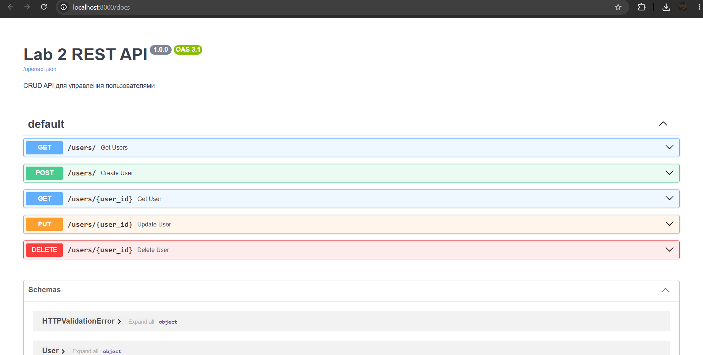
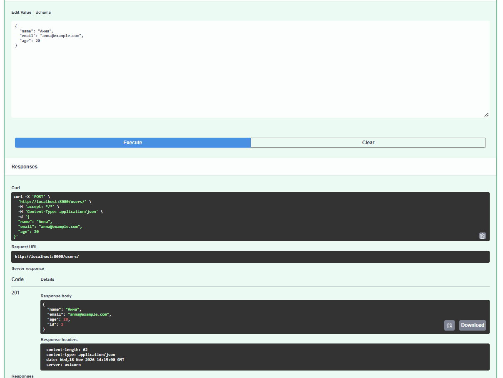

# Лабораторная работа 2

**После лекций:** 3 (Проектирование HTTP API)  
**Тема:** REST API для CRUD операций

## Задачи
* Проектирование API для сущности (`User`)
* Реализация endpoints: `GET`, `POST`, `PUT`, `DELETE`
* Правильные статус-коды
* OpenAPI спецификация

## Стек технологий
* **Язык:** Python 3.11
* **Фреймворк:** FastAPI + Uvicorn
* **Валидация данных:** Pydantic
* **Контейнеризация:** Docker, Docker Compose

## Структура проекта
```text
lab2/
├── app.py               # Логика REST API, Pydantic-модели и CRUD-эндпоинты
├── requirements.txt     # Зависимости проекта
├── Dockerfile           # Сборка Docker-образа
├── docker-compose.yml   # Запуск контейнера и проброс портов (8000:8000)
├── screenshots/         # Скриншоты работы Swagger UI
└── README.md            # Документация к лабораторной работе
```

## Реализация задач

### 1. Проектирование сущности `User`
С помощью Pydantic описаны модели для разделения входящих данных, обновления и ответа сервера:
* `UserCreate` (`name`, `email`, `age`) — схема для создания записи.
* `UserUpdate` (`name`, `email`, `age`) — схема для частичного или полного обновления.
* `User` (`id`, `name`, `email`, `age`) — модель ответа API с уникальным идентификатором.

### 2. Реализованные endpoints и HTTP статус-коды
* **`POST /users/`** — создание нового пользователя → статус **`201 Created`** (ошибка валидации — `422 Unprocessable Entity`).
* **`GET /users/`** — получение списка всех пользователей → статус **`200 OK`**.
* **`GET /users/{user_id}`** — получение пользователя по ID → статус **`200 OK`** (если не найден — **`404 Not Found`**).
* **`PUT /users/{user_id}`** — обновление данных пользователя по ID → статус **`200 OK`** (если не найден — **`404 Not Found`**).
* **`DELETE /users/{user_id}`** — удаление пользователя по ID → статус **`204 No Content`** (если не найден — **`404 Not Found`**).

### 3. OpenAPI спецификация
На основе аннотаций типов и Pydantic-схем FastAPI автоматически генерирует спецификацию OpenAPI 3.1 (`/openapi.json`) и интерактивную документацию Swagger UI (`/docs`).

## Инструкция по запуску

1. Перейдите в папку второй лабораторной работы:
   ```bash
   cd lab2
   ```

2. Соберите и запустите контейнер через Docker Compose:
   ```bash
   docker compose up --build
   ```

3. Откройте в браузере интерактивную документацию:
   * Swagger UI: [http://localhost:8000/docs](http://localhost:8000/docs)
   * OpenAPI JSON: [http://localhost:8000/openapi.json](http://localhost:8000/openapi.json)

4. Для остановки контейнера выполните:
   ```bash
   docker compose down
   ```

## Скриншоты работы



## Результат
* Реализован полноценный CRUD API для сущности `User` с валидацией данных и корректными HTTP статус-кодами.
* Настроена и проверена интерактивная документация API (OpenAPI 3.1 / Swagger UI).
* Закреплено понимание REST-принципов проектирования HTTP API, проект упакован в Docker-контейнер.