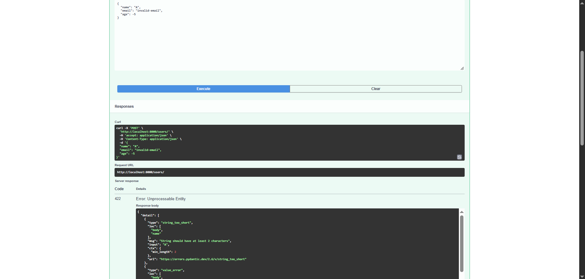
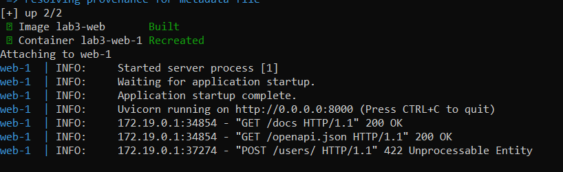

# Лабораторная работа 3: Валидация и обработка ошибок в API

## Задачи
* Валидация входных данных (формат, тип, диапазон)
* Реализация бизнес-правил
* Обработка ошибок (`4xx`, `5xx`)
* Понятные сообщения об ошибках
* Логирование ошибок

## Стек технологий
* **Язык:** Python 3.11
* **Фреймворк:** FastAPI + Uvicorn
* **Валидация данных:** Pydantic (включая `EmailStr` и ограничения `Field`)
* **Логирование:** Python `logging`
* **Контейнеризация:** Docker, Docker Compose

## Структура проекта

* `app.py`               # Код API с валидацией, бизнес-правилами и логированием
* `requirements.txt`     # Зависимости проекта (fastapi, uvicorn, pydantic[email])
* `Dockerfile`           # Инструкция для сборки Docker-образа
* `docker-compose.yml`   # Конфигурация запуска контейнера и проброса портов (8000:8000)
* `screenshots/`         # Скриншоты работы валидации, ошибок и логов
* `README.md`            # Документация к лабораторной работе


## Реализация задач

### 1. Валидация входных данных
С помощью Pydantic и модификаторов `Field` и `EmailStr` реализована строгая проверка параметров на уровне схемы:
* `name` — строка длиной от 2 до 50 символов.
* `email` — строгая проверка валидного формата адреса электронной почты (`EmailStr`).
* `age` — целое число в допустимом диапазоне от 0 до 120 лет (`ge=0, le=120`).

### 2. Бизнес-правила
* **Уникальность email:** при попытке создания (`POST`) или обновления (`PUT`) пользователя проверяется, не занят ли данный email кем-то из существующих пользователей. Если email уже существует, генерируется ошибка со статусом **`409 Conflict`**.

### 3. Обработка ошибок и статус-коды
* **`422 Unprocessable Entity`** — автоматическая ошибка Pydantic при нарушении типов данных, формата email или выходе чисел за разрешённые диапазоны.
* **`404 Not Found`** — возвращается через `HTTPException`, если запись с запрашиваемым `user_id` не обнаружена в базе.
* **`409 Conflict`** — бизнес-ошибка при попытке создания дубликата email.
* **`201 Created` / `200 OK` / `204 No Content`** — корректные успешные ответы для успешных CRUD-операций.

### 4. Логирование ошибок и событий
В коде приложения настроен модуль `logging`, который фиксирует ключевые этапы обработки запросов: успешное создание пользователей, предупреждения о нарушении бизнес-правил (конфликты email), а также ошибки при поиске или удалении несуществующих записей.

## Инструкция по запуску

1. Перейдите в директорию третьей лабораторной работы:
   ```bash
   cd lab3
   ```

2. Соберите образ и запустите контейнер с помощью Docker Compose:
   ```bash
   docker compose up --build
   ```

3. Откройте интерактивную документацию в браузере:
   * Swagger UI: [http://localhost:8000/docs](http://localhost:8000/docs)

4. Для остановки и удаления контейнера выполните:
   ```bash
   docker compose down
   ```

## Скриншоты работы



## Результат
* Разработан надёжный REST API с продвинутой валидацией Pydantic.
* Реализована корректная обработка всех сценариев (обычные, граничные и ошибочные статусы `4xx`, `409`, `422`).
* Настроено структурное логирование для отслеживания работы сервиса.
